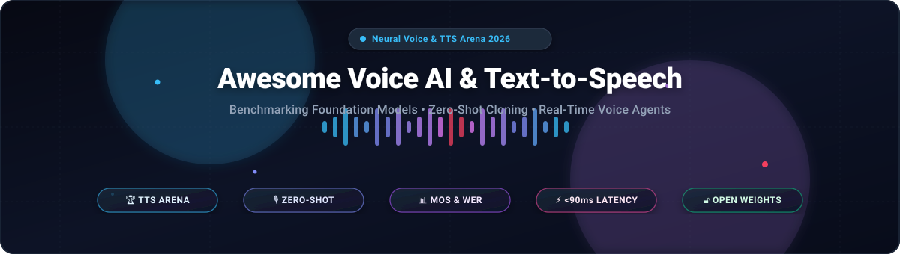
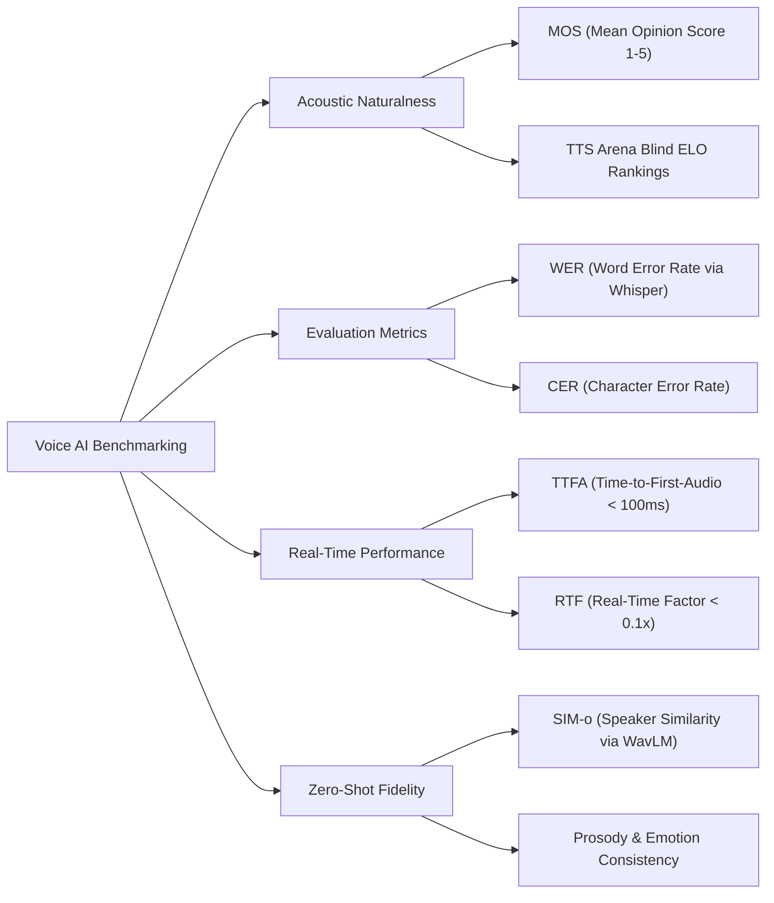

# 🎙️ Awesome Voice AI & Text-to-Speech (TTS) Benchmarking ⚡

**A curated index of state-of-the-art Neural Text-to-Speech (TTS) engines, zero-shot voice cloning foundation models, TTS Arena ELO leaderboards, MOS/WER evaluation suites, and conversational voice AI infrastructure.** 🎧🚀

*Last updated: November 2026*

---

## 📑 Table of Contents

- [🌐 Sector Overview & Market Dynamics](#-sector-overview--market-dynamics)
- [☁️ SaaS/Hosted Platforms](#️-saashosted-platforms)
- [💻 Open-Source GitHub Projects](#-open-source-github-projects)
- [🔬 Key Benchmarking Dimensions](#-key-benchmarking-dimensions)
- [📈 Star History](#-star-history)
- [🤝 Support & Sponsorship](#-support--sponsorship)
- [🛠️ How to Contribute](#️-how-to-contribute)
- [📜 Disclaimer & License](#-disclaimer--license)

---

## 🌐 Sector Overview & Market Dynamics

The global Voice AI and Text-to-Speech (TTS) sector is projected to expand from **$4.1B–$4.4B in 2026 to $8B–$11.5B by 2030** for standalone speech synthesis (~15–19% CAGR), while the broader conversational voice AI and real-time generative audio ecosystem is surging toward **$21B–$35B by 2030** (~30–39% CAGR). 📈

The industry displays a bifurcated market structure: **moderately concentrated at the cloud hyperscale foundation layer** (where major cloud providers like Microsoft Azure, Google Cloud, AWS, and frontier foundation labs command nearly 47% of core enterprise infrastructure revenue), yet **highly fragmented across vertical applications and specialized voice cloning agents** (where agile platforms such as ElevenLabs, Cartesia, WellSaid Labs, and Murf compete aggressively on sub-90ms streaming latency, expressive conversational prosody, and specialized workflow tooling). 🎯

---

## ☁️ SaaS/Hosted Platforms

The following hosted voice AI platforms provide commercial text-to-speech, real-time voice streaming APIs, instant voice cloning, and objective ELO-based speech arena evaluations. Platforms are sorted in descending order by estimated valuation/market cap scale. 🏆

| Platform | Starting Tier Pricing | Free Tier Limits | Scale / Valuation | Key Strengths & Architecture |
| :--- | :--- | :--- | :--- | :--- |
| **[Microsoft Azure AI Speech](https://azure.microsoft.com/en-us/products/ai-services/speech-to-text)** | $16.00 per 1M characters (Standard S0 Neural) | 500,000 characters free / month (F0 Free Tier, renews monthly) | **$3.1T+ Market Cap** (Enterprise Cloud) | Prebuilt HD neural voices, Custom Neural Voice (CNV) avatar fine-tuning, SSML prosody modulation, viseme facial animation outputs, and cross-region enterprise compliance. |
| **[Google Cloud Text-to-Speech](https://cloud.google.com/text-to-speech)** | $4.00 per 1M chars (Standard/WaveNet); $16.00 per 1M chars (Neural2); $30.00 per 1M chars (Chirp 3) | 4M characters / month (Standard); 1M characters / month (Neural2/Chirp) free forever | **$2.1T+ Market Cap** (Google Cloud) | Chirp 3 and Journey foundation voices powered by Gemini audio models, 220+ languages, instant custom voice cloning, and Google Cloud IAM/VPC security. |
| **[Amazon Polly](https://aws.amazon.com/polly/)** | $4.00 per 1M chars (Standard); $16.00 per 1M chars (Neural); $30.00 per 1M chars (Generative) | 5M chars / month (Standard, free forever); 1M chars / month (Neural, first 12 months) | **$2.0T+ Market Cap** (Amazon Web Services) | Generative engine with ultra-natural conversational cadence, synchronous and asynchronous audio synthesis, dynamic speech marks (visemes), and AWS ecosystem integration. |
| **[ElevenLabs](https://elevenlabs.io)** | $6.00 / month (Starter Plan with 30,000 monthly credits) | 10,000 credits (~10 minutes) / month free forever (strictly non-commercial, attribution required) | **$22.0B Valuation** ($600M+ ARR) | Leading generative voice foundation platform, Flash v2.5 / Turbo v2.5 sub-100ms models, instant and professional zero-shot voice cloning, and conversational agent orchestration. |
| **[Resemble AI](https://resemble.ai)** | $0.00 / month pay-as-you-go Flex tier (Team plan from $350 / month for 5 seats) | Free Flex account with initial trial credits for testing TTS and voice cloning | **$2.5B–$5.0B Est. Valuation** (~$3.8M ARR) | Real-time speech-to-speech voice transformation, granular emotional inflection controls, and integrated PerTh neural perceptual watermarking for deepfake governance. |
| **[PlayHT](https://play.ht)** | $39.00 / month (Professional / Creator Plan, billed annually) | 5,000 free words / month forever (personal non-commercial use, requires attribution) | **Meta Acquisition** (~$7.3M ARR prior to buyout) | Real-time low-latency streaming TTS APIs, conversational agents via Play.ai, 800+ AI voices, emotion style steering, and podcast audio hosting. |
| **[Cartesia (Sonic)](https://cartesia.ai)** | $5.00 / month (Pro Plan with 100,000 monthly credits) | 20,000 credits / month forever (capped at 2 concurrent requests, non-commercial only) | **$340M+ Est. Valuation** ($71M+ Total Funding) | State-Space Model (SSM) architecture delivering sub-90ms time-to-first-audio (TTFA), ultra-fast edge and cloud streaming, and custom brand voice cloning. |
| **[Speechify](https://speechify.com)** | $11.58 / month ($139.00 billed annually for Premium; $29 / month if billed monthly) | Free forever plan limited to 10 standard voices and maximum 1.5x speed (listening only, no audio downloads) | **$100M+ Est. Valuation** ($130M+ Total Funding) | Cross-platform document reading, OCR integration for physical texts and PDFs, 1,000+ realistic voices across 60+ languages, and developer TTS API. |
| **[Murf.ai](https://murf.ai)** | $19.00 / month (Creator Plan, billed annually at $228 / year) | Free forever plan with 10 minutes total voice generation across 3 projects (downloads disabled, strictly non-commercial) | **$50M–$100M Est. Valuation** ($10M Series A, ~$8M ARR) | Cloud-based voiceover studio with fine-grained pitch, speed, emphasis, and pause controls, timeline-based video/audio synchronization, and Google Slides add-ons. |
| **[WellSaid Labs](https://wellsaidlabs.com)** | $10.00 / month (Starter Plan with 250 download mins/year, billed annually) | 7-day free trial with 3 downloadable audio minutes and single-user studio access | **$50M–$65M Est. Valuation** ($12M Total Funding, ~$8.3M ARR) | Studio-grade enterprise synthetic voice avatars, custom phonetic respelling dictionaries, collaborative team workspaces, and SOC 2 Type II compliance. |
| **[LOVO AI (Genny)](https://lovo.ai)** | $24.00 / month (Basic Plan with 2 hours voice generation / month, billed annually) | 14-day free trial of Pro with limited generation minutes (file downloads and commercial rights disabled) | **$25M–$40M Est. Valuation** ($13M+ Total Funding, ~$8.4M ARR) | Integrated AI voice generator and video editor featuring 500+ expressive voices in 100+ languages, auto-subtitling, and stock media assets. |
| **[Artificial Analysis Speech Arena](https://artificialanalysis.ai)** | Free public benchmarking leaderboards; Custom private evaluation from $5,000+ | Full public access to TTS Arena ELO scores, latency benchmarks, and pricing index | **Seed Funded** (AI Grant backed by Nat Friedman & Daniel Gross) | Gold-standard independent benchmarking platform evaluating commercial and open-weight TTS engines on blind human ELO preference, time-to-first-audio latency, and price per million tokens. |

---

## 💻 Open-Source GitHub Projects

Curated collection of open-source neural text-to-speech models, diffusion audio synthesis frameworks, dialogue-first speech LLMs, and automated evaluation suites. Each repository includes a star count badge linking directly to its GitHub Stargazers page, sorted by star count in descending order. 🌟

| Project & Repository | Stars | Primary Architecture | Description & Core Capabilities |
| :--- | :--- | :--- | :--- |
| **[VoiceStudio](https://github.com/debpalash/VoiceStudio)** |  | Desktop AI Studio & Multi-TTS Workbench | Comprehensive desktop workbench integrating leading open-weight TTS engines, real-time voice cloning, audio post-processing, and multi-speaker script rendering. |
| **[GPT-SoVITS](https://github.com/RVC-Boss/GPT-SoVITS)** |  | Few-Shot GPT + VITS | Powerful zero-shot and 1-minute few-shot voice cloning and cross-lingual TTS supporting English, Japanese, and Chinese with interactive WebUI and fine-tuning toolkits. |
| **[Real-Time Voice Cloning (SV2TTS)](https://github.com/CorentinJ/Real-Time-Voice-Cloning)** |  | SV2TTS Deep Learning Framework | Seminal open-source zero-shot voice cloning framework implementing SV2TTS (Speaker Verification to Multispeaker TTS) with an interactive real-time generation UI. |
| **[Coqui TTS](https://github.com/coqui-ai/TTS)** |  | Multi-Architecture Deep Learning Suite | Legendary deep learning toolkit for text-to-speech featuring XTTS-v2 voice cloning across 17 languages, VITS, Tacotron2, and streaming inference servers. |
| **[ChatTTS](https://github.com/2noise/ChatTTS)** |  | Conversational Speech LLM | Conversational speech generation model specifically engineered for multi-speaker dialogue, realistic laughs, conversational hesitations, and natural breath sounds. |
| **[Bark](https://github.com/suno-ai/bark)** |  | Transformer-based Audio LM | Text-prompted generative audio model by Suno synthesizing expressive multilingual speech, background noise, laughter, crying, sighing, and musical cadence. |
| **[RVC (Retrieval-based Voice Conversion)](https://github.com/RVC-Project/Retrieval-based-Voice-Conversion-WebUI)** |  | Speech-to-Speech Voice Conversion WebUI | State-of-the-art real-time voice conversion platform using VITS and top-pitch algorithms (Harvest, Crepe) for zero-shot and custom vocal timbre conversion. |
| **[OpenVoice](https://github.com/myshell-ai/OpenVoice)** |  | Tone Color Converter + Acoustic Model | Instant zero-shot voice cloning system decoupling vocal timbre from rhythm and emotion, enabling flexible cross-lingual style transfer and expressive control. |
| **[Fish Speech](https://github.com/fishaudio/fish-speech)** |  | Dual-Autoregressive Transformer | Fast, phoneme-free multilingual TTS architecture with zero-shot and few-shot voice cloning capabilities in English, Chinese, Japanese, and European languages. |
| **[Chatterbox](https://github.com/resemble-ai/chatterbox)** |  | Production Neural TTS | MIT-licensed open-source voice cloning model from Resemble AI featuring emotion exaggeration multipliers and built-in PerTh audio watermarking. |
| **[CosyVoice & CosyVoice 2](https://github.com/FunAudioLLM/CosyVoice)** |  | Flow Matching + Multi-Scale DiT | Alibaba's Apache-2.0 speech generation foundation model featuring multi-lingual zero-shot cloning, fine-grained cross-lingual emotion steering, and streaming inference. |
| **[Dia-1.6B](https://github.com/nari-labs/dia)** |  | Dialogue Speech Foundation Model | 1.6-billion-parameter open-weight dialogue-first TTS model natively synthesizing multi-party conversations and non-verbal conversational tokens from script tags. |
| **[F5-TTS](https://github.com/SWivid/F5-TTS)** |  | Flow-Matching Diffusion Transformer | Non-autoregressive Flow Matching DiT for text-to-speech with high zero-shot naturalness, multi-speaker dialogue sequencing, and speedup via ODE solvers. |
| **[Tortoise TTS](https://github.com/neonbjb/tortoise-tts)** |  | Autoregressive & Diffusion TTS | Breakthrough expressive neural text-to-speech system combining autoregressive decoders and diffusion vocoders for hyper-realistic speech and voice cloning. |
| **[Sesame CSM-1B](https://github.com/SesameAILabs/csm)** | [ | Conversational Speech Model | Context-aware generative dialogue speech model conditioning prosody and vocal acoustics on antecedent multi-turn conversational history. |
| **[PaddleSpeech](https://github.com/PaddlePaddle/PaddleSpeech)** |  | Baidu Speech & Audio Suite | Comprehensive open-source speech and audio framework by Baidu featuring FastSpeech2, Tacotron2, VITS, multilingual synthesis, and voice conversion. |
| **[SpeechBrain](https://github.com/speechbrain/speechbrain)** |  | PyTorch Speech Toolkit | Comprehensive, all-in-one conversational speech toolkit supporting end-to-end TTS, ASR, voice activity detection, speaker verification, and emotion classification. |
| **[SeamlessCommunication (Meta)](https://github.com/facebookresearch/seamless_communication)** |  | Meta Expressive Speech Translation & S2S | Meta AI foundational library for expressive multilingual speech-to-speech translation and synthesis preserving vocal timbre, emotion, and cadence. |
| **[Moshi](https://github.com/kyutai-labs/moshi)** |  | Full-Duplex Audio-Language Model | Real-time speech-text foundation model by Kyutai Labs operating full-duplex conversational audio with sub-200ms latency in PyTorch and Rust. |
| **[Piper TTS](https://github.com/rhasspy/piper)** |  | VITS + ONNX Runtime | Ultra-fast, lightweight, private local neural text-to-speech engine running faster than real-time on Raspberry Pi 4 and edge/IoT home automation hardware. |
| **[Spark-TTS](https://github.com/SparkAudio/Spark-TTS)** |  | Single-Stream BiCodec + LLM | End-to-end speech synthesis model based on Qwen2.5 with fine-grained acoustic control over gender, pitch, speaking pace, and zero-shot reference cloning. |
| **[Kokoro-82M](https://github.com/hexgrad/kokoro)** |  | Lightweight StyleTTS2 Variant | Apache-2.0, 82M parameter foundation TTS model delivering human-tier naturalness and benchmark-leading ELO scores with blistering CPU/ONNX execution speeds. |
| **[ESPnet](https://github.com/espnet/espnet)** |  | End-to-End Speech Processing | Research-grade speech processing platform supporting state-of-the-art TTS architectures, vocoders, CTC/attention decoding, and acoustic benchmarks. |
| **[EmotiVoice](https://github.com/netease-youdao/EmotiVoice)** |  | Multi-Voice + Emotion TTS | Highly expressive open-source TTS engine by NetEase Youdao supporting over 2,000 distinct voices and emotional speech prompt conditioning. |
| **[VALL-E-X](https://github.com/Plachtaa/VALL-E-X)** |  | Neural Codec Language Model | Open-source implementation of Microsoft's zero-shot cross-lingual neural codec language model synthesizing speech in another language while preserving the original voice profile. |
| **[VITS](https://github.com/jaywalnut310/vits)** |  | Variational Autoencoder + GAN | Foundational single-stage parallel end-to-end text-to-speech architecture utilizing variational inference and adversarial training for natural prosody. |
| **[MeloTTS](https://github.com/myshell-ai/MeloTTS)** |  | High-Speed Multilingual TTS | Ultra-lightweight multilingual text-to-speech system by MyShell featuring native accent support in English, Spanish, French, Chinese, Japanese, and Korean on standard CPU. |
| **[Orpheus-TTS](https://github.com/canopyai/Orpheus-TTS)** |  | Llama Speech-LLM | Apache-2.0 speech language model engineered with inline paralinguistic tags (`<laugh>`, `<sigh>`, `<gasp>`) and ultra-low streaming latency. |
| **[StyleTTS 2](https://github.com/yl4579/StyleTTS2)** |  | Diffusion Style Modeling + SLM | Breakthrough end-to-end TTS architecture combining diffusion models and large speech language model discriminators to achieve human-level speech naturalness. |
| **[Kokoro-FastAPI](https://github.com/remsky/Kokoro-FastAPI)** |  | High-Performance Kokoro API Server | Production-ready OpenAI-compatible HTTP and streaming WebSocket API server wrapping the Kokoro-82M TTS model with multi-voice blending. |
| **[Parler-TTS](https://github.com/huggingface/parler-tts)** |  | Controllable Audio Transformer | Lightweight open-source model by Hugging Face generating speech conditioned on natural-language descriptive prompts (speaker gender, pitch, cadence, and room acoustics). |
| **[WhisperSpeech](https://github.com/collabora/WhisperSpeech)** |  | Inverted Whisper + EnCodec | Open-source text-to-speech architecture designed by Collabora and Lion, reversing Whisper representations to synthesize clean, natural speech from text. |
| **[TensorFlowTTS](https://github.com/TensorSpeech/TensorFlowTTS)** |  | TensorFlow 2 Real-Time TTS | Production-grade speech synthesis toolkit providing FastSpeech2, MelGAN, Multi-Band MelGAN, and Tacotron2 in TensorFlow 2. |
| **[AllTalk TTS](https://github.com/erew123/alltalk_tts)** |  | Multi-Engine WebUI & Local API | Comprehensive local TTS studio and API server supporting XTTS-v2, Piper, Parler-TTS, and VITS with multi-voice narrator modes and low-VRAM streaming. |
| **[Coqui-TTS (Idiap Community Fork)](https://github.com/idiap/coqui-ai-TTS)** |  | Community-Maintained Coqui Suite | Active open-source continuation and maintenance fork of the official Coqui TTS library by Idiap Research Institute with modern CUDA and PyTorch compatibility. |
| **[Seed-TTS-Eval](https://github.com/BytedanceSpeech/seed-tts-eval)** |  | Standardized Evaluation Suite | ByteDance's benchmarking harness for zero-shot TTS measuring Word Error Rate (WER via Whisper) and Speaker Similarity (SIM via WavLM) on CommonVoice and LibriSpeech test splits. |
| **[OuteTTS](https://github.com/edwko/OuteTTS)** |  | Pure LLM Architecture (GGUF) | Pure language-modeling TTS engine compatible with `llama.cpp` and GGUF quantization formats for low-footprint local inference on CPU and Apple Silicon. |
| **[OpenedAI Speech](https://github.com/matatonic/openedai-speech)** |  | OpenAI-Compatible Speech API | Self-hosted drop-in replacement for OpenAI /v1/audio/speech API backed by Piper and XTTS-v2 for seamless integration into voice agents and WebUIs. |
| **[UTMOSv2 & SpeechMOS](https://github.com/sarulab-speech/UTMOSv2)** |  | Neural MOS Predictor | State-of-the-art neural Mean Opinion Score (MOS) prediction tool computing automatic human perceptual quality ratings for synthesized speech without manual listening panels. |

---

## 🔬 Key Benchmarking Dimensions

When comparing Text-to-Speech models across enterprise and open-source stacks, consider the following evaluation metrics:

1. **Blind Human ELO (TTS Arena):** Crowdsourced A/B listening evaluations (pioneered by Artificial Analysis and Hugging Face Open TTS Leaderboard) rating comparative realism, emotional resonance, and listener preference. 🎧
2. **Mean Opinion Score (MOS):** Standardized metric (1.0 to 5.0) measuring naturalness, predicted automatically via neural models like `UTMOSv2` or collected via human MUSHRA listening tests. 📊
3. **Intelligibility (WER & CER):** Objective evaluation calculated by feeding synthesized audio back into leading automatic speech recognition (ASR) models (e.g., Whisper-large-v3, Paraformer) to measure mispronounced or dropped words. 📝
4. **Speaker Similarity (SIM-o):** Cosine similarity between speaker embeddings (extracted via `WavLM-TDNN` or `ECAPA-TDNN`) of the reference audio and the synthesized output. 🧬
5. **Time-to-First-Audio (TTFA):** Streaming synthesis latency from request receipt to the first audio packet, vital for real-time conversational agents (target: `<100ms`). ⏱️
6. **Real-Time Factor (RTF):** Ratio of synthesis compute time to audio duration. An RTF of `< 0.1` indicates the model generates 10 seconds of audio in under 1 second. ⚡

---

## 📈 Star History

---

## 🤝 Support & Sponsorship

Thank you so much for using and exploring this Voice AI & Text-to-Speech benchmarking repository! ⭐

If you find this curated directory helpful for your research, voice agent builds, or generative audio projects, please consider:
- **Starring (⭐)** the repository on GitHub to help others discover it.
- **Forking (🍴)** and contributing new TTS foundation models and benchmark results.
- **Sharing (📢)** this resource with fellow speech engineers, audio researchers, and AI builders.
- **Sponsoring / Buying a Coffee (☕)**: If you'd like to support ongoing curation and benchmarking updates, check out the [Sponsor Dashboard](https://github.com/sponsors/ishandutta2007). Every contribution makes a huge difference! 💖

---

## 🛠️ How to Contribute

Contributions are warmly encouraged! To propose a new SaaS platform, foundation model, or benchmarking harness:

1. **Fork the repository** on GitHub.
2. **Create a descriptive feature branch**: `git checkout -b add-model-name`.
3. **Format your entry**:
   - For SaaS products: Provide concrete pricing, explicit free tier allowances (avoiding "Custom" or "N/A"), and verified valuation/revenue scale.
   - For Open-Source repositories: Ensure the repository link is valid and follows the format with social badge and direct link to stargazers.
4. **Submit a Pull Request** with a concise summary of the addition and official reference links.

---

## 📜 Disclaimer & License

- **Disclaimer:** Product pricing, free tier limits, and corporate valuations represent public and industry estimates recorded as of late 2026. Official vendor terms may vary over time.
- **License:** Content curated in this repository is distributed under the [Creative Commons Zero v1.0 Universal (CC0-1.0)](https://creativecommons.org/publicdomain/zero/1.0/) public domain dedication.
